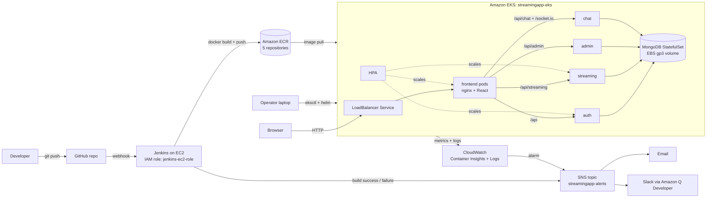

# StreamingApp: Orchestration & Scaling on AWS

End-to-end DevOps deployment of the **StreamingApp** MERN microservices application on AWS:
containerised with **Docker**, stored in **Amazon ECR**, built automatically by **Jenkins** on every
`git push`, deployed to **Amazon EKS** with **Helm**, auto-scaled with the **Horizontal Pod Autoscaler**,
monitored with **Amazon CloudWatch**, and wired to **Slack** for ChatOps alerts through **Amazon SNS**.

> All evidence screenshots live in the [`Screenshots/`](Screenshots/) folder and are embedded in the
> relevant sections below. All AWS resources were deleted after validation to avoid cost; the
> configuration in this repository recreates everything.

## Table of contents

1. [Project overview](#1-project-overview)
2. [Architecture](#2-architecture)
3. [Repository layout](#3-repository-layout)
4. [Step 1: Version control (fork & sync)](#4-step-1-version-control-fork--sync)
5. [Step 2: Containerise the application](#5-step-2-containerise-the-application)
6. [Step 3: AWS CLI & IAM setup](#6-step-3-aws-cli--iam-setup)
7. [Step 2 (continued): Push images to Amazon ECR](#7-step-2-continued-push-images-to-amazon-ecr)
8. [Step 4: Continuous Integration with Jenkins](#8-step-4-continuous-integration-with-jenkins)
9. [Step 5: Kubernetes deployment on EKS with Helm](#9-step-5-kubernetes-deployment-on-eks-with-helm)
10. [Scaling (HPA)](#10-scaling-hpa)
11. [Step 6: Monitoring & logging with CloudWatch](#11-step-6-monitoring--logging-with-cloudwatch)
12. [Step 9: ChatOps with SNS + Slack](#12-step-9-chatops-with-sns--slack)
13. [Step 8: Final validation](#13-step-8-final-validation)
14. [Problems faced & fixes](#14-problems-faced--fixes)
15. [Future improvements](#15-future-improvements)
16. [Application reference](#16-application-reference)

---

## 1. Project overview

| Item | Value |
| --- | --- |
| Application | StreamingApp: React frontend + 4 Node.js microservices (auth, streaming, admin, chat) + MongoDB |
| Cloud / region | AWS, `ap-south-1` (Mumbai) |
| Upstream repo | <https://github.com/UnpredictablePrashant/StreamingApp> |

**Tools and versions used**

| Purpose | Tool | Version |
| --- | --- | --- |
| Source control | Git / GitHub | git 2.55 |
| Containers | Docker Desktop | 29.6 |
| AWS access | AWS CLI v2 | 2.37 (laptop), 2.38 (Jenkins server) |
| Image registry | Amazon ECR | 5 private repositories |
| CI server | Jenkins LTS on EC2 (Ubuntu 24.04, Java 21) | 2.580.1 |
| Kubernetes | Amazon EKS | Kubernetes 1.34 |
| Cluster provisioning | eksctl | 0.231.0 |
| Kubernetes CLI | kubectl | 1.36 |
| Packaging / deploy | Helm | v4.3.0 |
| Monitoring & logs | CloudWatch Container Insights + Fluent Bit (EKS add-on `amazon-cloudwatch-observability`) | v6.7.0 |
| Alerts / ChatOps | Amazon SNS + Amazon Q Developer in chat applications (Slack) | n/a |

---

## 2. Architecture



**Request flow.** The browser talks to **one** public address: the AWS load balancer created by the
`frontend` Service. The frontend container runs nginx, which serves the React build and acts as a
**reverse proxy**: it forwards `/api/...` calls to the right backend Service by name. The backends are
private (ClusterIP) and are never exposed to the internet. All backends share one MongoDB, which runs
as a StatefulSet with its own EBS disk.

**Services in the cluster**

| Service | Port | Health path | Replicas | Why |
| --- | --- | --- | --- | --- |
| frontend (nginx + React) | 80 | `/` | 2–5 (HPA) | Stateless, public entry point |
| auth | 3001 | `/health` | 2–5 (HPA) | Stateless, handles login traffic |
| streaming | 3002 | `/api/health` | 2–5 (HPA) | Stateless catalogue/playback API |
| admin | 3003 | `/api/health` | 1 | Low traffic (admins only) |
| chat | 3004 | `/api/health` | 1 (fixed) | Socket.IO keeps connected users in memory, so multiple replicas would split chat rooms |
| mongo | 27017 | n/a | 1 (StatefulSet) | Single database instance with a persistent EBS volume |

---

## 3. Repository layout

| Path | Purpose |
| --- | --- |
| `backend/*/Dockerfile` | One image per backend microservice |
| `frontend/Dockerfile` | Multi-stage build: Node builds React, nginx serves it |
| `frontend/nginx.conf` | nginx reverse proxy: routes `/api/...` to backend Services |
| `docker-compose.yml` | Local run of the full stack (all 5 services + MongoDB) |
| `Jenkinsfile` | CI pipeline: build, push to ECR, notify SNS (Pipeline as Code) |
| `infra/eks-cluster.yaml` | eksctl cluster definition (Infrastructure as Code) |
| `helm/streamingapp/` | Helm chart for the whole application |
| `Screenshots/` | Evidence for every step |

---

## 4. Step 1: Version control (fork & sync)

The upstream repository was forked to <https://github.com/Rishav-Mukhopadhyay/HeroVired_Assignment_Orchestration-Scaling>,
and the original repository was added as a second remote called `upstream`.

```bash
git remote add upstream https://github.com/UnpredictablePrashant/StreamingApp.git
git remote -v                               # origin = fork, upstream = original

# Sync procedure
git fetch upstream                          # download upstream changes (changes nothing locally)
git log --oneline main..upstream/main       # commits upstream has that the fork does not
git log --oneline upstream/main..main       # commits the fork has that upstream does not
git merge upstream/main                     # only if the first log shows new commits
```

At the start of the project both logs were empty, so the fork was already in sync.

---

## 5. Step 2: Containerise the application

Every component already had a Dockerfile; they were reviewed, tested locally, and the frontend was improved.

**Images and build contexts** (the build context matters and differs per service):

| Image | Dockerfile | Build context |
| --- | --- | --- |
| auth | `backend/authService/Dockerfile` | `backend/authService` |
| streaming | `backend/streamingService/Dockerfile` | `backend` |
| admin | `backend/adminService/Dockerfile` | `backend` |
| chat | `backend/chatService/Dockerfile` | `backend` |
| frontend | `frontend/Dockerfile` | `frontend` |

### 5.1 Frontend: reverse proxy and relative URLs

The React app reads its backend URLs (`REACT_APP_*`) **at build time**. With the original
`http://localhost:300x` values, a deployed frontend would try to call the user's own computer.

**Solution:** [`frontend/nginx.conf`](frontend/nginx.conf) was added and copied into the nginx stage
of the Dockerfile. nginx forwards each path prefix to a backend by its service name; nginx picks the
longest matching prefix, so the order of the blocks doesn't matter:

| Path | Forwarded to |
| --- | --- |
| `/api/streaming/` | `streaming:3002` |
| `/api/admin/` | `admin:3003` |
| `/api/chat/`, `/socket.io/` (WebSocket upgrade) | `chat:3004` |
| `/api/` | `auth:3001` |
| anything else | `index.html` (React routing; refreshing `/login` no longer returns 404) |

The frontend is then built with **relative** URLs (`/api`, `/api/admin`, `/api/chat`, `/`).
The same image works locally with docker-compose and on EKS, because the Service names are identical
in both. It also needs only one public load balancer instead of five.

### 5.2 Local test with docker-compose

```powershell
# .env (git-ignored) - relative URLs for the frontend build
REACT_APP_AUTH_API_URL=/api
REACT_APP_STREAMING_API_URL=/api
REACT_APP_STREAMING_PUBLIC_URL=/
REACT_APP_ADMIN_API_URL=/api/admin
REACT_APP_CHAT_API_URL=/api/chat
REACT_APP_CHAT_SOCKET_URL=/

docker compose up --build -d
docker compose ps
curl.exe http://localhost:3001/health        # auth
curl.exe http://localhost:3002/api/health    # streaming
curl.exe http://localhost:3003/api/health    # admin
curl.exe http://localhost:3004/api/health    # chat
```

Register and login were verified in the browser before moving to AWS.


*The 5 images built locally.*


*All 6 containers running with their ports published.*


*The same stack in Docker Desktop.*


*All four backend health endpoints answering.*


*The app running at `http://localhost:3000`.*

---

## 6. Step 3: AWS CLI & IAM setup

1. **IAM user** `devops-cli` was created for command-line access (never the root account). For this
   lab it has `AdministratorAccess`, because eksctl manages VPC, EC2, IAM and CloudFormation; in production
   a least-privilege policy would be used.
2. An **access key** was created for the *CLI* use case and configured locally with `aws configure`
   (region `ap-south-1`, output `json`). The key was stored only in `~/.aws/credentials`, never
   in the repository, and was **deleted after the project**.
3. A **$20 monthly budget** with email alerts was created as a cost safety net.

```powershell
aws configure                 # access key, secret, ap-south-1, json
aws sts get-caller-identity   # verify: shows user/devops-cli
```


*Creating the `devops-cli` IAM user.*


*Attaching `AdministratorAccess` (lab only).*


*User created.*


*Access key created for the CLI use case.*


*Monthly cost budget template.*


*The `devops-project` budget ($20) created.*


*The CLI authenticated as `user/devops-cli`.*

---

## 7. Step 2 (continued): Push images to Amazon ECR

Five private repositories were created in the ECR console: `streamingapp-frontend`, `streamingapp-auth`,
`streamingapp-streaming`, `streamingapp-admin` and `streamingapp-chat`. The locally built images were
then tagged and pushed:

```powershell
$ACCOUNT  = aws sts get-caller-identity --query Account --output text
$REGION   = "ap-south-1"
$REGISTRY = "$ACCOUNT.dkr.ecr.$REGION.amazonaws.com"

# temporary (12 h) registry password piped straight into docker login
aws ecr get-login-password --region $REGION | docker login --username AWS --password-stdin $REGISTRY

# repeat for each service: auth, streaming, admin, chat, frontend
docker tag  herovired_assignment_orchestration-scaling-auth "$REGISTRY/streamingapp-auth:v1"
docker push "$REGISTRY/streamingapp-auth:v1"
```


*Creating a private ECR repository (the same was done for all five).*


*All 5 repositories.*


*ECR login, tag and push from the laptop.*


*`streamingapp-auth` with tag `v1`.*

<details>
<summary>The other four repositories with their <code>v1</code> image</summary>


</details>

---

## 8. Step 4: Continuous Integration with Jenkins

### 8.1 IAM role for the Jenkins server (no access keys on the server)

Instead of copying an access key onto the server, the EC2 instance gets an **IAM role**
(`jenkins-ec2-role`). AWS gives the instance short-lived credentials automatically, so there is
nothing on the server that can leak.

| Policy | Why |
| --- | --- |
| `AmazonEC2ContainerRegistryPowerUser` (AWS managed) | Push/pull images to ECR |
| `jenkins-sns-publish` (inline, added in Step 9) | `sns:Publish` on the `streamingapp-alerts` topic **only** |


*Trusted entity: the EC2 service.*


*Permission: `AmazonEC2ContainerRegistryPowerUser`.*


*Role name `jenkins-ec2-role`.*

### 8.2 EC2 instance

| Setting | Value | Reason |
| --- | --- | --- |
| AMI | Ubuntu Server 24.04 LTS (x86) | Most common for Jenkins |
| Type | t3.medium (2 vCPU, 4 GB) | Building the React frontend needs ~4 GB RAM |
| Disk | 30 GB gp3 | Docker images fill the default 8 GB quickly |
| Security group `jenkins-sg` | Inbound 22 (SSH / Instance Connect), 8080 (Jenkins UI + GitHub webhook) | Outbound left as default (all) |
| IAM instance profile | `jenkins-ec2-role` | Credentials without keys |


*Name and Ubuntu 24.04 AMI.*


*Instance type t3.medium and key pair.*


*Inbound rules for 22 and 8080.*


*Network settings using `jenkins-sg`.*


*30 GiB gp3 root volume.*


*IAM instance profile `jenkins-ec2-role`.*


*Instance running.*

### 8.3 Install Java, Jenkins, Docker and AWS CLI

Run through **EC2 Instance Connect** (a browser terminal):

```bash
# Java (Jenkins requires Java 21)
sudo apt-get update
sudo apt-get install -y fontconfig openjdk-21-jre

# Jenkins LTS (note: the repository signing key is the 2026 key)
sudo wget -O /etc/apt/keyrings/jenkins-keyring.asc https://pkg.jenkins.io/debian-stable/jenkins.io-2026.key
echo "deb [signed-by=/etc/apt/keyrings/jenkins-keyring.asc] https://pkg.jenkins.io/debian-stable binary/" | sudo tee /etc/apt/sources.list.d/jenkins.list > /dev/null
sudo apt-get update && sudo apt-get install -y jenkins

# Docker, and allow the jenkins user to use it
sudo apt-get install -y docker.io
sudo usermod -aG docker jenkins
sudo usermod -aG docker ubuntu
sudo systemctl restart jenkins

# AWS CLI v2
sudo apt-get install -y unzip
curl "https://awscli.amazonaws.com/awscli-exe-linux-x86_64.zip" -o awscliv2.zip
unzip -q awscliv2.zip && sudo ./aws/install

# Verify AS THE JENKINS USER
sudo systemctl is-active jenkins             # active
sudo -u jenkins docker ps                    # no "permission denied"
sudo -u jenkins aws sts get-caller-identity  # assumed-role/jenkins-ec2-role/...
```


*Jenkins can use Docker, and gets its AWS identity from the instance role (`assumed-role/jenkins-ec2-role`).*

Jenkins was then unlocked at `http://<EC2-IP>:8080` with
`/var/lib/jenkins/secrets/initialAdminPassword`, the suggested plugins were installed (they include the
GitHub plugin and Pipeline Stage View), and an admin user was created.


*Installing the suggested plugins.*


*Jenkins ready.*

### 8.4 Pipeline as Code: the `Jenkinsfile`

The pipeline uses plain `docker` and `aws` shell commands (the same ones used manually in Step 2), so no
Docker or AWS Jenkins plugins are needed.

| Stage | What it does |
| --- | --- |
| Checkout | Clones the repository at the pushed commit |
| Login to ECR | `aws ecr get-login-password \| docker login` (credentials come from the instance role) |
| Build images | Builds all 5 images with the correct build contexts; the frontend gets relative `REACT_APP_*` URLs |
| Push images | Pushes each image twice: `:<BUILD_NUMBER>` (traceable, allows rollback) and `:latest` |
| Post actions | `docker image prune -f` (keeps the disk clean) and an SNS notification on success or failure (Step 9) |

See [`Jenkinsfile`](Jenkinsfile) for the full pipeline.

### 8.5 Pipeline job

Job `streamingapp-ci`: type **Pipeline**, definition **Pipeline script from SCM**, Git repository of
this fork, branch `*/main`, script path `Jenkinsfile`.


*Creating the `streamingapp-ci` pipeline.*


*Pipeline script from SCM, branch `*/main`.*


*Build #1: every stage green.*


*Build #1 summary.*


*Console output ending in `Finished: SUCCESS`.*

### 8.6 Trigger on every commit (GitHub webhook)

1. Jenkins job → **Triggers** → *GitHub hook trigger for GITScm polling*.
2. GitHub repository → **Settings → Webhooks** → Payload URL `http://<EC2-IP>:8080/github-webhook/`
   (the trailing slash is required), content type `application/json`, *just the push event*.


*The GitHub hook trigger enabled on the job.*


*Webhook configuration in GitHub.*


*Webhook delivered successfully (green tick).*


*Build #2 started automatically after a push.*


*Build #2: "Started by GitHub push", which is the proof of automatic CI.*

---

## 9. Step 5: Kubernetes deployment on EKS with Helm

### 9.1 Create the cluster with eksctl (Infrastructure as Code)

[`infra/eks-cluster.yaml`](infra/eks-cluster.yaml) defines the cluster:

- `streamingapp-eks` in `ap-south-1`, with a dedicated VPC created by eksctl
- `iam.withOIDC: true` lets individual add-ons get their own IAM role (IRSA)
- the `aws-ebs-csi-driver` add-on lets Kubernetes create EBS volumes, used by MongoDB
- a managed node group `ng-general` of 2 × t3.medium (min 1, max 3, 20 GB disk)
- `withAddonPolicies.cloudWatch: true` gives the nodes permission to send metrics and logs to CloudWatch (Step 6)

```powershell
eksctl create cluster -f infra/eks-cluster.yaml --dry-run   # validate, creates nothing
eksctl create cluster -f infra/eks-cluster.yaml             # ~15-20 min
kubectl get nodes
kubectl get pods -A
eksctl get addons --cluster streamingapp-eks --region ap-south-1
```

eksctl also installs `vpc-cni`, `coredns`, `kube-proxy` and **`metrics-server`** (needed by the HPA) as EKS add-ons.


*eksctl builds the cluster through CloudFormation stacks.*


*All 4 stacks complete: cluster, node group, and IAM roles for the vpc-cni and EBS CSI add-ons.*


*2 nodes Ready, system pods Running, add-ons ACTIVE (the EBS CSI driver has its own IAM role).*


*The cluster in the EKS console (Kubernetes 1.34, Active).*

### 9.2 The Helm chart

[`helm/streamingapp/`](helm/streamingapp/) packages the whole application. It renders **18 Kubernetes
objects** from one settings file:

| Template | Objects | Notes |
| --- | --- | --- |
| `config.yaml` | ConfigMap + Secret | Shared settings (`MONGO_URI`, `CLIENT_URLS`, `STREAMING_PUBLIC_URL`, AWS region) and the shared `JWT_SECRET`. The secret is `required`, so Helm refuses to install without it. |
| `mongo.yaml` | StorageClass (gp3), headless Service, StatefulSet | `volumeClaimTemplates` gives MongoDB a 5 GiB EBS volume that survives pod restarts |
| `backends.yaml` | 4 × Deployment + 4 × Service | One template loops (`range`) over the `backends:` map in `values.yaml`. It sets readiness/liveness probes on each health path, CPU/memory requests and limits, and a `checksum/config` annotation so that config changes automatically roll the pods. |
| `frontend.yaml` | Deployment + Service `type: LoadBalancer` | The only public entry point |
| `hpa.yaml` | 3 × HorizontalPodAutoscaler | auth, streaming, frontend: 2–5 pods at 60 % CPU |
| `NOTES.txt` | n/a | Post-install instructions |

The Service names `auth`, `streaming`, `admin` and `chat` deliberately match `nginx.conf` and `docker-compose.yml`.

```powershell
helm lint helm/streamingapp --set jwtSecret=test                                       # 0 failed
helm template streamingapp helm/streamingapp                                           # fails on purpose: secret required
helm template streamingapp helm/streamingapp --set jwtSecret=test | Select-String "^kind:"   # 18 objects
```

### 9.3 Deploy

```powershell
# 1. generate a strong random JWT secret (kept only in the terminal, never committed)
$bytes = New-Object byte[] 32
[System.Security.Cryptography.RandomNumberGenerator]::Create().GetBytes($bytes)
$JWT = [Convert]::ToBase64String($bytes)

# 2. install
helm install streamingapp helm/streamingapp --set jwtSecret=$JWT
kubectl get pods -w

# 3. get the load balancer address and give it to the backends (CORS allow-list + public URL)
kubectl get svc frontend
helm upgrade streamingapp helm/streamingapp --reuse-values --set publicUrl=http://<EXTERNAL-IP>
```


*`helm install` (the secret is passed as a variable, never written to a file).*


*Pods starting and passing their readiness probes.*


*LoadBalancer address, then `helm upgrade` with `publicUrl`.*

### 9.4 Application running on EKS


*The app served from the AWS load balancer.*


*Registered and logged in on the EKS deployment.*


*Browser network tab: `/api/streaming/videos` is called on the same ELB address and answered via nginx, which proves the reverse proxy works.*

---

## 10. Scaling (HPA)

| Setting | Value |
| --- | --- |
| Scaled workloads | auth, streaming, frontend |
| Replicas | min 2, max 5 |
| Target | 60 % average CPU (relative to the 100m CPU request) |
| Metrics source | `metrics-server` (EKS add-on) |

**Load test.** A temporary busybox pod ran 4 parallel request loops against the auth service:

```powershell
kubectl run load-generator --image=busybox:1.36 --restart=Never -- /bin/sh -c "for i in 1 2 3 4; do (while true; do wget -q -O- http://auth:3001/health > /dev/null; done) & done; wait"
kubectl get hpa auth -w
kubectl delete pod load-generator
```

| Time (HPA age) | CPU vs target | Replicas | What happened |
| --- | --- | --- | --- |
| 14m | 1 % / 60 % | 2 | Idle at the minimum |
| 14m | 168 % / 60 % | 2 | Load starts |
| 15m | 168–224 % / 60 % | 4 → 5 | HPA scales out to the maximum |
| 16m | 126 % → 91 % | 5 | Load spread over 5 pods |
| 18m | 1 % | 5 | Load stopped; HPA waits (scale-down stabilisation window) |
| 23m | 1 % | 2 | Scaled back in to the minimum |


*The three autoscalers at rest.*


*Scaling out from 2 to 5 auth pods.*


*Scaling back in to 2 after the load stopped.*

**Not scaled, on purpose:** `chat` (Socket.IO state in memory; scaling it would need a Redis adapter),
`admin` (low traffic) and `mongo` (single database instance). **Node scaling:** the node group allows
1–3 nodes, but automatic node scaling would need Cluster Autoscaler or Karpenter (see Future improvements).

---

## 11. Step 6: Monitoring & logging with CloudWatch

### 11.1 CloudWatch Observability add-on

Installed from the EKS console (**Add-ons → Get more add-ons → Amazon CloudWatch Observability**), with
permissions inherited from the node role (the `cloudWatch` policy from `eks-cluster.yaml`). It runs:

- **CloudWatch agent** (DaemonSet), which collects node, pod and container metrics into **Container Insights**
- **Fluent Bit** (DaemonSet), which ships every container's stdout/stderr to **CloudWatch Logs**


*Selecting the add-on.*


*Review and add.*


*Add-on Active.*


*Agent and Fluent Bit pods running on both nodes.*

### 11.2 Metrics: Container Insights


*Container Insights overview.*


*Cluster performance.*


*Node performance.*


*Pod performance.*

### 11.3 Centralised logs

| Log group | Contents |
| --- | --- |
| `/aws/containerinsights/streamingapp-eks/application` | Application logs from **all pods** |
| `/aws/containerinsights/streamingapp-eks/performance` | Raw performance events |
| `/aws/containerinsights/streamingapp-eks/dataplane`, `/host` | Kubernetes and node system logs |

Logs Insights query (it also returns logs from pods that no longer exist, such as the extra HPA replicas):

```
fields @timestamp, kubernetes.pod_name, log
| filter kubernetes.container_name = "auth"
| sort @timestamp desc
| limit 50
```


*The four Container Insights log groups.*


*The Logs Insights query returning auth logs.*

### 11.4 Alarm + SNS email

| Setting | Value |
| --- | --- |
| Alarm | `streamingapp-auth-high-cpu` |
| Metric | `ContainerInsights / pod_cpu_utilization_over_pod_limit` (ClusterName, Namespace, Service = auth) |
| Condition | Average > 20 % for 1 datapoint of 1 minute (deliberately low so the load test triggers it; production would use something like 80 % for 5 minutes) |
| Action | SNS topic `streamingapp-alerts` → email (and Slack, Step 9) |

The alarm was proven by re-running the load generator; it fired with 27.4 % > 20 %.


*Metric and threshold.*


*Creating the SNS topic with an email subscription.*


*The subscription confirmation email.*


*Alarm action sending to `streamingapp-alerts`.*


*Alarm name.*


*Load generator used to trigger the alarm.*


*Alarm email: the threshold was crossed (27.4 > 20).*

---

## 12. Step 9: ChatOps with SNS + Slack

```
CloudWatch alarm ─┐
                  ├─► SNS topic "streamingapp-alerts" ─► email
Jenkins build  ───┘                                  └─► Slack #streamingapp-alerts (Amazon Q Developer)
(success / failure)
```

### 12.1 SNS → Slack (Amazon Q Developer in chat applications)

1. Slack workspace `HeroViredDevOps`, public channel `#streamingapp-alerts`.
2. AWS console → *Amazon Q Developer in chat applications* → Slack → authorise the workspace.
3. Channel configuration `streamingapp-alerts`: channel role `chatops-slack-role` (created from a
   template), **guardrail `CloudWatchReadOnlyAccess`** (so the bot can never change anything), and the
   SNS topic `streamingapp-alerts` in `ap-south-1`.
4. `/invite @Amazon Q` in the channel.
5. Test without a cluster by forcing the alarm state:
   `aws cloudwatch set-alarm-state --alarm-name streamingapp-auth-high-cpu --state-value ALARM --state-reason "Testing Slack ChatOps integration"`


*Choosing Slack as the chat client.*


*Allowing the Amazon Q app in the workspace.*


*Workspace authorised.*


*Channel configuration.*


*Channel role and the read-only guardrail.*


*Mapping the SNS topic.*


*Channel configured.*


*Amazon Q added to the channel.*


*Forcing the alarm into ALARM.*


*The alarm card in Slack, with a metric graph.*


*The same alarm delivered by email.*

### 12.2 Jenkins → SNS → Slack (build success / failure)

1. Inline policy `jenkins-sns-publish` on `jenkins-ec2-role`, allowing only `sns:Publish` on
   `arn:aws:sns:ap-south-1:<ACCOUNT_ID>:streamingapp-alerts` (least privilege).
2. Tested from the server first:
   ```bash
   sudo -u jenkins aws sns publish --region ap-south-1 \
     --topic-arn arn:aws:sns:ap-south-1:<ACCOUNT_ID>:streamingapp-alerts \
     --message '{"version":"1.0","source":"custom","content":{"title":"Hello from Jenkins","description":"Testing Jenkins to SNS to Slack"}}'
   ```
   Slack only displays messages in the Amazon Q Developer **custom notification** JSON format
   (`version`, `source: custom`, `content`); plain text is ignored by the Slack channel.
3. A `notifySns()` helper in the `Jenkinsfile` is called from `post { success {...} failure {...} }`:
   ```groovy
   def notifySns(String status) {
       sh """
           aws sns publish --region ${env.AWS_REGION} --topic-arn ${env.SNS_TOPIC_ARN} \
             --message '{"version":"1.0","source":"custom","content":{"textType":"client-markdown","title":"${status}: ${env.JOB_NAME} #${env.BUILD_NUMBER}","description":"Image tag: ${env.IMAGE_TAG}\\nDetails: ${env.BUILD_URL}"}}'
       """
   }
   ```
4. The failure path was tested with Jenkins **Replay** (adding `sh 'exit 1'` temporarily, without a commit).


*`jenkins-ec2-role` before the change.*


*Inline policy JSON (one action, one topic).*


*Policy name `jenkins-sns-publish`.*


*The role with both policies.*


*SNS publish test from the server.*


*The test message in Slack.*


*Replay with a temporary `exit 1`.*


*Build #6 succeeded; build #7 (the replay) failed as intended.*


*Success and failure messages in Slack.*


*The same notifications by email (raw JSON, which is expected).*

---

## 13. Step 8: Final validation

| Requirement | Result | Evidence |
| --- | --- | --- |
| Frontend accessible | ✅ Served from the AWS load balancer | §9.4 |
| Backend functional | ✅ Register/login on EKS; API calls answered through nginx | §9.4 |
| All pods healthy | ✅ 9/9 Running, readiness/liveness probes passing, MongoDB volume Bound | §9.3 |
| Images built and pushed by CI | ✅ Jenkins builds #1–#6 push `:<build>` + `:latest` to ECR | §8.5 |
| Automatic trigger on commit | ✅ "Started by GitHub push" | §8.6 |
| Scaling | ✅ HPA 2 → 5 → 2 under load | §10 |
| Monitoring and alarms | ✅ Container Insights, alarm fired, email received | §11 |
| Centralised logging | ✅ Fluent Bit → CloudWatch Logs, Logs Insights query | §11.3 |
| ChatOps | ✅ Alarm and build success/failure in Slack | §12 |

---

## 14. Problems faced & fixes

| Problem | Cause | Fix / lesson |
| --- | --- | --- |
| `Bind for 127.0.0.1:3000 failed: port is already allocated` | Another local project was using port 3000 | `docker ps --filter "publish=3000"` to find the container, stop it, then `docker compose up -d --force-recreate frontend` (the half-created container had no port mapping) |
| `the attribute version is obsolete` warning | Compose v2 no longer uses `version:` | Removed the line from `docker-compose.yml` |
| `docker compose down`: *no configuration file provided* | Command run outside the project folder | `cd` into the folder that contains `docker-compose.yml` |
| Jenkins install: `NO_PUBKEY 7198F4B714ABFC68`, repository not signed | Jenkins rotated its apt signing key (2023 → 2026) | Downloaded `jenkins.io-2026.key` from the official install page |
| `usermod: user 'jenkins' does not exist` | Jenkins hadn't installed (previous error) | Fixed the key first; the package then creates the user |
| Instance metadata `curl` returned nothing | IMDSv2 requires a session token | `PUT /latest/api/token`, then send the `X-aws-ec2-metadata-token` header |
| Frontend would call `localhost` after deployment | React bakes `REACT_APP_*` in at build time | nginx reverse proxy + relative URLs (§5.1) |
| `helm lint`: *Chart.yaml not found* | Chart folder created inside `frontend/`, `NOTES.txt` outside `templates/` | Moved `helm/` to the repository root and `NOTES.txt` into `templates/` |
| No Slack message after editing the `Jenkinsfile`; Replay failed without notifying (build #5) | The change was only local; Jenkins reads the `Jenkinsfile` from GitHub, and Replay re-used the old script | Committed and pushed, then replayed a build that used the new script |
| Jenkins webhook stopped after restarting EC2 | A stopped/started instance gets a new public IP | Updated the GitHub webhook URL and the *Jenkins URL* setting (an Elastic IP would avoid this) |
| "Details" links in Slack messages were malformed (`http://<ip>/:8080/...`) | Typo in **Manage Jenkins → System → Jenkins URL** (a `/` before `:8080`) | The value should be `http://<ip>:8080/`; noticed afterwards in the Slack screenshots |


*Build #5: a replay of an older build that didn't contain the notification code.*

---

## 15. Future improvements

- **HTTPS**: a custom domain with an ACM certificate on the load balancer, or AWS Load Balancer Controller + Ingress.
- **Continuous Deployment**: add a Jenkins stage that runs `helm upgrade --set image.tag=$BUILD_NUMBER` against EKS (needs an EKS access entry for `jenkins-ec2-role`).
- **Node auto-scaling**: Cluster Autoscaler or Karpenter, so that new nodes are added when pods can't be scheduled.
- **Database**: enable MongoDB authentication, or use a managed service (Amazon DocumentDB / MongoDB Atlas) with backups.
- **Chat scaling**: a Socket.IO Redis adapter (ElastiCache) so that `chat` can run multiple replicas.
- **Supply-chain security**: ECR scan-on-push or Trivy in the pipeline; ECR lifecycle policies to expire old tags.
- **Secrets**: AWS Secrets Manager + External Secrets Operator instead of `--set`.
- **Static Jenkins address**: an Elastic IP or DNS name so the webhook survives restarts.

---

## 16. Application reference

*(Original application documentation from the upstream repository, kept for reference.)*

Stream premium video content, host live watch parties, and manage your catalogue with a modern microservice architecture. The platform ships with an admin portal, real-time chat, S3-backed adaptive streaming, and a cinematic frontend experience.

| Service | Port | Description |
| --- | --- | --- |
| `authService` | 3001 | User authentication, registration, JWT issuance |
| `streamingService` | 3002 | Video catalogue, S3 playback endpoints, public APIs |
| `adminService` | 3003 | Dedicated admin microservice for asset management and uploads |
| `chatService` | 3004 | Websocket + REST chat for live watch parties |
| `frontend` | 3000 | React SPA with integrated chat |
| `mongo` | 27017 | Shared MongoDB instance |

### Environment configuration

Each service reads its settings from environment variables (or a local `.env` file). All services accept the standard AWS credentials for S3 access.

**Auth service** (`backend/authService/.env`)
```ini
PORT=3001
MONGO_URI=mongodb://localhost:27017/streamingapp
JWT_SECRET=changeme
CLIENT_URLS=http://localhost:3000
AWS_ACCESS_KEY_ID=
AWS_SECRET_ACCESS_KEY=
AWS_REGION=ap-south-1
AWS_S3_BUCKET=
```

**Streaming service** (`backend/streamingService/.env`)
```ini
PORT=3002
MONGO_URI=mongodb://localhost:27017/streamingapp
JWT_SECRET=changeme
CLIENT_URLS=http://localhost:3000
AWS_ACCESS_KEY_ID=
AWS_SECRET_ACCESS_KEY=
AWS_REGION=ap-south-1
AWS_S3_BUCKET=
AWS_CDN_URL=
STREAMING_PUBLIC_URL=http://localhost:3002
```

**Admin service** (`backend/adminService/.env`)
```ini
PORT=3003
MONGO_URI=mongodb://localhost:27017/streamingapp
JWT_SECRET=changeme
CLIENT_URLS=http://localhost:3000
AWS_ACCESS_KEY_ID=
AWS_SECRET_ACCESS_KEY=
AWS_REGION=ap-south-1
AWS_S3_BUCKET=
```

**Chat service** (`backend/chatService/.env`)
```ini
PORT=3004
MONGO_URI=mongodb://localhost:27017/streamingapp
JWT_SECRET=changeme
CLIENT_URLS=http://localhost:3000
```

**Frontend build variables** (`frontend/.env` or Docker build args). Use relative values (`/api`, ...) when the frontend runs behind the nginx reverse proxy; see §5.1.
```ini
REACT_APP_AUTH_API_URL=http://localhost:3001/api
REACT_APP_STREAMING_API_URL=http://localhost:3002/api
REACT_APP_STREAMING_PUBLIC_URL=http://localhost:3002
REACT_APP_ADMIN_API_URL=http://localhost:3003/api/admin
REACT_APP_CHAT_API_URL=http://localhost:3004/api/chat
REACT_APP_CHAT_SOCKET_URL=http://localhost:3004
```

### Running with Docker Compose

```bash
docker compose up --build
```

Then open `http://localhost:3000`. The compose file provisions MongoDB plus all four Node.js microservices. S3 credentials are optional for local testing; streaming requires valid S3 objects.

### Local development (without Docker)

```bash
cd backend/authService && npm install && npm run dev
cd backend/streamingService && npm install && npm run dev
cd backend/adminService && npm install && npm run dev
cd backend/chatService && npm install && npm run dev
cd frontend && npm install && npm start
```

### Feature highlights

- S3-backed adaptive streaming with secure signed uploads for admins
- Dedicated admin microservice for video ingestion, metadata management and featured curation
- Real-time chat overlay in the player (Socket.IO + persistent message history)
- Role-aware access control across frontend routes and backend microservices

### License

MIT © StreamFlix Team
